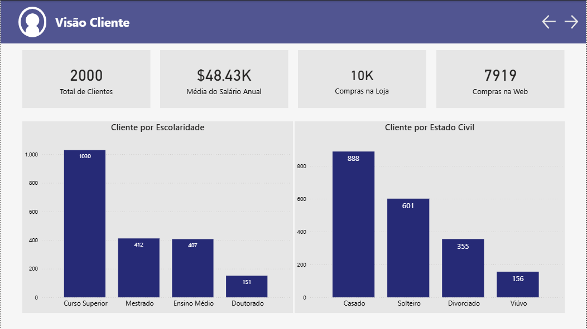
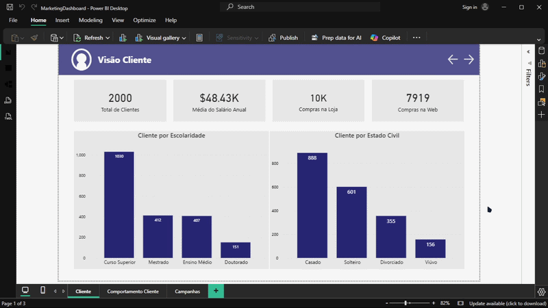
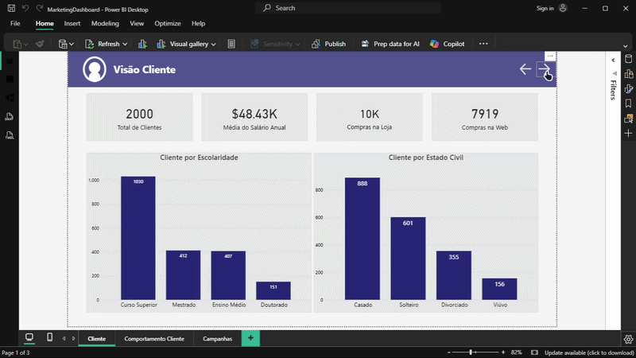
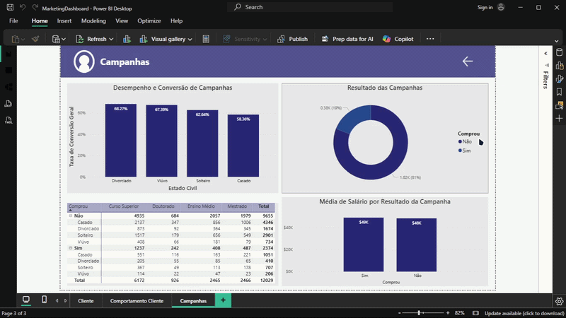

# Client Performance Panel



A Business Intelligence project aimed at the marketing sector. The main objective is to analyze how was the clients' reception for the campaigns done, and utilizing Big Query by Google Cloud fdata quality engineering and Power BI for multidimensional modeling (DAX).

---

## Architecture Overview

```text
[Big Query] ➔ [Script SQL para ter as colunas das campanhas] ➔ [Dashboard no Power BI]
```

## The SQL Script (Data Extraction)

The SQL script was designed to select the columns as previously mentioned, extracting only the data required for the analysis:

```SQL
SELECT
ID,
Ano_Nascimento,
Escolaridade,
Estado_Civil,
Salario_Anual,
Filhos_Em_Casa,
Adolescentes_Em_Casa,
Data_Cadastro,
Dias_Desde_Ultima_Compra,
(Gastos_Eletronicos + Gastos_Brinquedos + Gastos_Moveis + Gastos_Utilidades + Gastos_Alimentos + Gastos_Vestuario) AS Gasto_Total_MKT,
Num_Compras_Desconto,
(Num_Compras_Web + Num_Compras_Catalogo + Num_Compras_Loja) AS Total_Compras,
Num_Visitas_Website_Mes,
-- Se você só precisa saber se o cliente aceitou alguma campanha (Sim/Não ou 1/0)
IF(Campanha1 + Campanha2 + Campanha3 + Campanha4 + Campanha5 > 0, 1, 0) AS Aceitou_Campanha,
Comprou
FROM

Marketing.Campaigns
```
Focusing on dashboard optimization and performance, I consolidated the `Total_Compras` columns. Additionally, I aggregated the total number of purchases per customer—excluding the number of discounted purchases—and finally, unpivoted the marketing campaign columns into a single dimension `Aceitou_Campanha`

---

## Technical & Business Highlights

The dashboard layout follows an executive information hierarchy:

## 1. Page 1: Customer Overview



*   **Total Customer Card:** Monitors the current customer base by calculating the distinct count of customer IDs.
*   **Average Annual Salary Card:** Displays the average annual income of the customer base.
*   **In-Store and Web Purchases Cards:** Tracks sales performance across e-commerce and physical retail channels.
*   **Customer Education Bar Chart:** Segmenting customers by education level allows for targeted marketing strategies, tailoring high-ticket offers to specific demographics.
*   **Customer Marital Status Bar Chart:** Visualizes purchase behavior across different marital statuses. For instance, a high concentration of married customers enables targeted campaigns focused on relationships, family gifts, or optimized ad spend during Valentine's Day.

---

## Page 2: Customer Behavior



*   **Total Spend vs. Annual Salary Scatter Plot:** This chart demonstrates that high-spending customers do not necessarily correlate with the highest annual incomes. Identifying this behavior allows for targeted promotional strategies and loyalty discounts aimed at high-value segments.
*   **Children and Teenagers vs. Annual Spend Bar Charts:** These charts analyze whether household composition (the presence of children or teenagers) influences annual spending patterns. The data streams were intentionally kept separate rather than aggregated, as households may concurrently include children under 14 and teenagers, each presenting distinct consumer behaviors.

---

## Page 3: Data Auditing & Sanitization



*   **Campaign Conversion Performance Bar Chart:** This visual tracks the percentage of customers who engaged with or accepted the marketing campaigns (note: engagement does not inherently imply a completed purchase). The metric was calculated using the following formula:


```DAX
Taxa de Conversão Regulatória = 
VAR TotalCompradores = 
    CALCULATE(
        COUNTA(MarketingData[Comprou]), 
        MarketingData[Comprou] = "Sim"
    )

RETURN
    DIVIDE(TotalCompradores, Gasto_Total_MKT, 0)

```

*   **Campaign Results Donut Chart:** Visualizes the breakdown between converting and non-converting customers, allowing stakeholders to identify the exact volume of customers who completed the entire conversion funnel.
*   **Customer Purchases Table:** Provides a granular view of top-performing customers alongside demographic dimensions such as marital status and education level, while also highlighting non-purchasing profiles. Note that non-purchasing customers may still have been influenced by the campaign touchpoints.
*   **Average Salary by Campaign Result Bar Chart:** Analyzes the relationship between average household income and campaign conversion outcomes.

---
## Tools & Technologies Used

*   **Claude:** Utilized for synthetic data generation through advanced prompt engineering techniques.
*   **DAX (Data Analysis Expressions):** Deployed for developing complex business metrics and KPIs, such as the `Conversion Rate`.
*   **Power BI Desktop:** Used for data modeling, advanced conditional formatting engineering, and data visualization.
*   **Google Cloud (GCP):** Acts as the data repository, ensuring all datasets are securely stored and managed in the cloud.
---

## Developer
*   **Diogo Oliveira**
